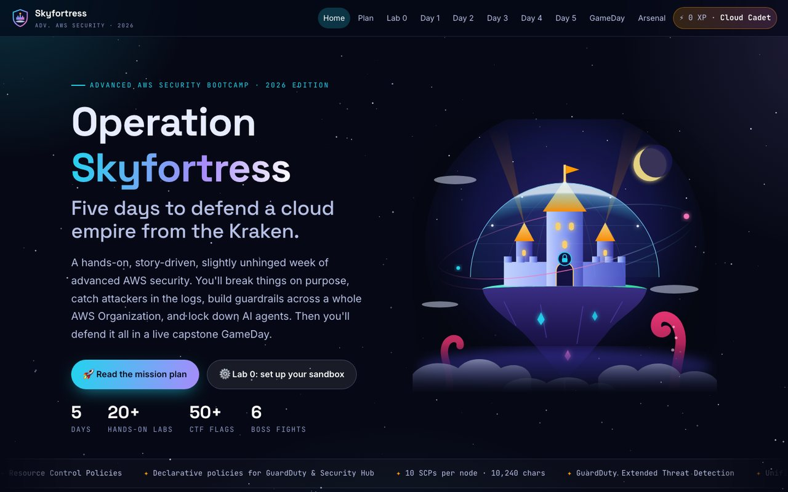
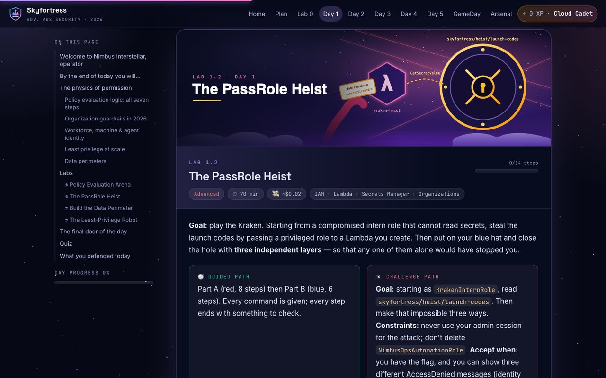
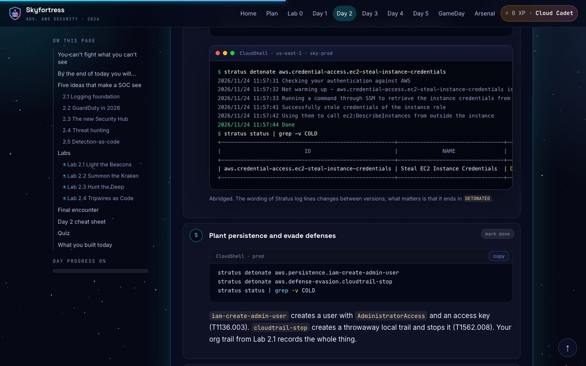
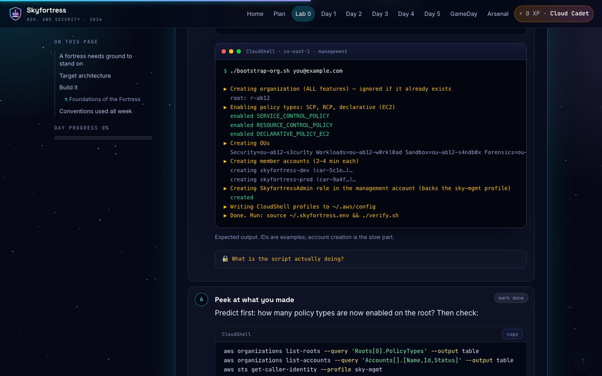
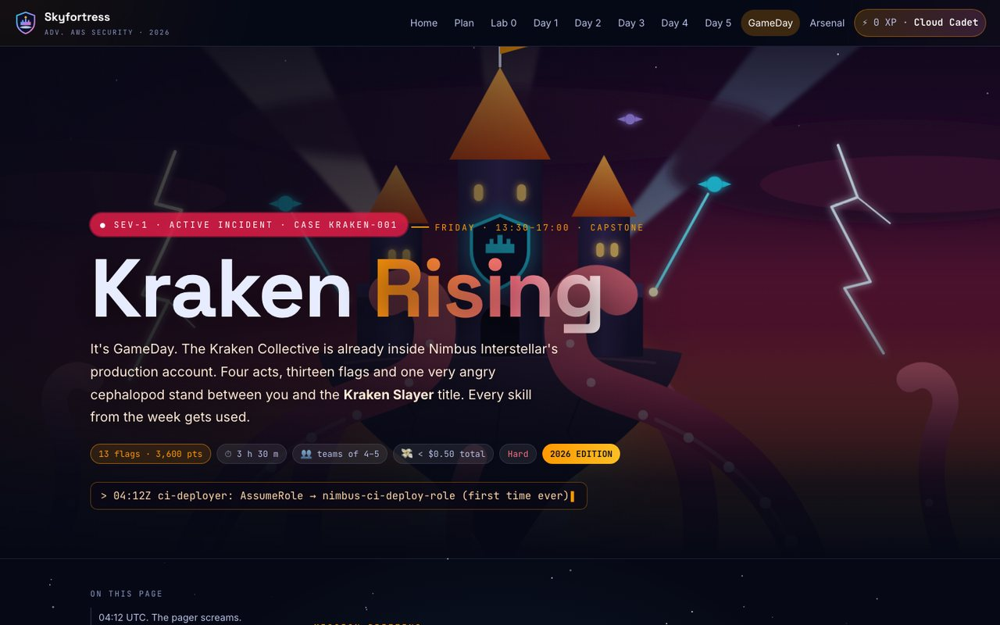

# 🏰 Operation Skyfortress: Advanced AWS Security Bootcamp (2026 edition)

**Live site → https://varoonsahgal.github.io/awsadvancedsecurity/**

A five-day, hands-on, gamified course on advanced AWS security. You break things on purpose, catch attackers in the logs, build guardrails across a whole AWS Organization, lock down AI agents, and then defend all of it in a live capstone GameDay.



## The week

| Day | Theme | Labs | Boss fight |
|---|---|---|---|
| 0 | [Lab 0: Foundations](https://varoonsahgal.github.io/awsadvancedsecurity/setup.html) | Sandbox AWS Organization, tooling, budgets | — |
| 1 | [Keys to the Kingdom](https://varoonsahgal.github.io/awsadvancedsecurity/day1.html): identity & org guardrails | Policy Evaluation Arena · The PassRole Heist · Build the Data Perimeter · Least-Privilege Robot | The Confused Deputy |
| 2 | [Eyes in the Sky](https://varoonsahgal.github.io/awsadvancedsecurity/day2.html): detection & threat hunting | Light the Beacons · Summon the Kraken · Hunt the Deep · Tripwires as Code | The 3 A.M. Backdoor |
| 3 | [Walls & Moats](https://varoonsahgal.github.io/awsadvancedsecurity/day3.html): network, workload & supply chain | Cut the Kraken's Line · Shields Up · Kubernetes Citadel · Poisoned Supply | DNS Tunnel Escape |
| 4 | [Vaults & Thinking Machines](https://varoonsahgal.github.io/awsadvancedsecurity/day4.html): data, crypto & AI security | Crypto Dojo · Ransom in the Clouds · Jailbreak the Starship AI · Leash the Agent | The Poisoned Manifest |
| 5 | [Kraken Rising](https://varoonsahgal.github.io/awsadvancedsecurity/day5.html): IR, forensics, automation | Burned Keys · Digital Autopsy · Autopilot Defense | The Kraken's Last Stand |
| 🏆 | [GameDay](https://varoonsahgal.github.io/awsadvancedsecurity/gameday.html): capstone | 13 flags across 4 acts in a pre-compromised environment | gd-final |

Also: [Course plan](https://varoonsahgal.github.io/awsadvancedsecurity/plan.html) · [Arsenal (cheat sheets)](https://varoonsahgal.github.io/awsadvancedsecurity/resources.html)

## What's inside every lab

| | |
|---|---|
|  |  |
| Cover art, plus a **guided path** and a **challenge path** | **Terminal screenshots** of the output you should expect |
|  |  |
| Console mock-ups, "predict before you run" boxes, troubleshooting tables | A scored capstone with a mission clock and live injects |

## 2026 content highlights

* SCPs in the full IAM language with the higher quotas (10 per node, 10,240 characters), RCPs, and declarative policies for EC2, GuardDuty and Security Hub CSPM
* IAM Identity Center's 2026 changes and the account access manager
* GuardDuty Extended Threat Detection, including the May 2026 indicators; the unified Security Hub, including AI inventory, AI Protection and Azure coverage
* Athena and Security Lake (OCSF) threat hunting (CloudTrail Lake closed to new customers on May 31, 2026)
* WAF vs bots and AI crawlers, EKS Pod Identity, and supply-chain signing
* KMS ML-DSA signing, ML-KEM hybrid TLS, and S3 SSE-C ransomware defense (with the 2026 SSE-C default)
* Bedrock Guardrails, plus AgentCore Policy (Cedar) for deterministic control of agent tool calls
* AWS Security Agent, AWS Security Incident Response, and NIST SP 800-61r3

## Run it locally

```bash
git clone https://github.com/varoonsahgal/awsadvancedsecurity.git
cd awsadvancedsecurity
python3 -m http.server 8000   # then open http://localhost:8000
```

Plain HTML/CSS/JS with no build step. `.nojekyll` makes GitHub Pages serve every file as-is.

## Repo layout

```
index.html plan.html setup.html day1-5.html gameday.html resources.html 404.html
assets/css/site.css     design system (component cheat sheets in the comments)
assets/js/site.js       nav/footer, starfield, copy buttons, tabs, TOC, lightbox, XP / flags / quizzes / badges
assets/img/             hand-built SVG illustrations, diagrams, console mock-ups; screens/ = page screenshots
labs/<day>/             CloudFormation / Terraform / scripts / policies used by the labs (browsable on the site)
_template.html          authoring template for new pages
```

Instructor answer keys (flag plaintexts, solutions, timing notes) are kept **out of this public repo**. Ask the course owner for access.

## Gamification

* Each lab step you mark done: +10 XP. Each correct quiz answer: +20 XP. Flags: 100–500 XP. Boss flags unlock badges.
* Flags look like `SKY{...}`. The site checks them by SHA-256 in your browser, so the plaintext isn't in the page source.
  To add one: `printf '%s' 'SKY{my_flag}' | shasum -a 256`, then put the hex in `data-hash`.
* Progress lives in `localStorage` (per browser). The footer has a reset link.

## Safety

Labs create intentionally vulnerable resources and simulate attacks. **Use only dedicated sandbox accounts you own.** Keep Lab 0's budget alarms, and run each lab's cleanup block. `labs/setup/nuke-check.sh` lists anything expensive that's still running.

Console mock-ups are illustrative; the live AWS console may look different. Nimbus Interstellar and The Kraken Collective are fictional.
